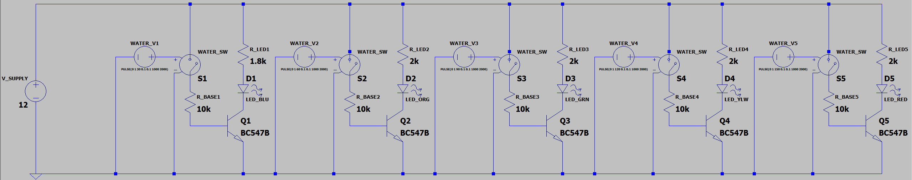
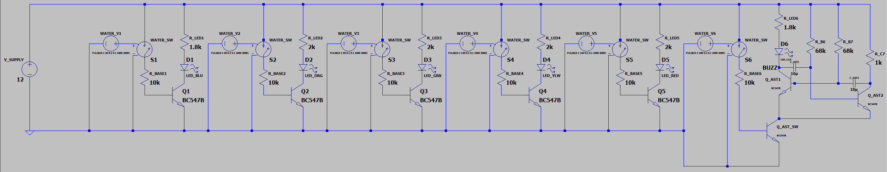
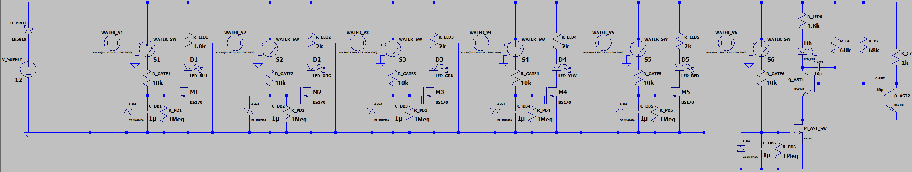
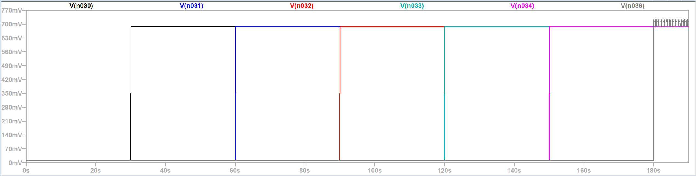
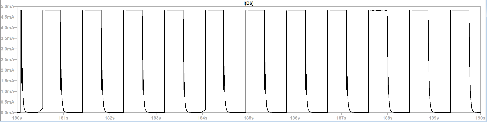
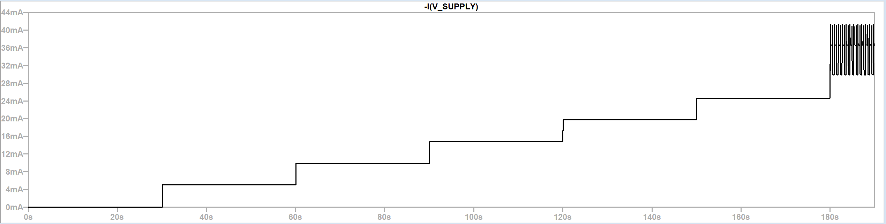
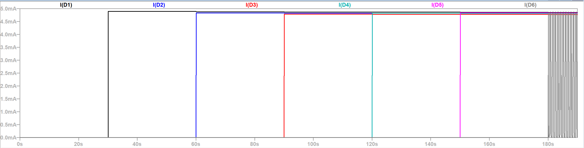
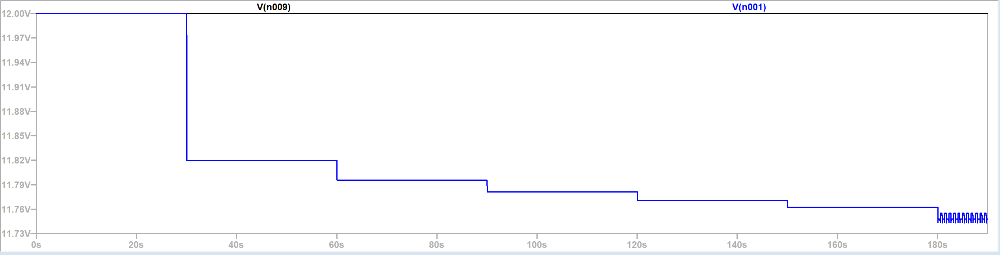
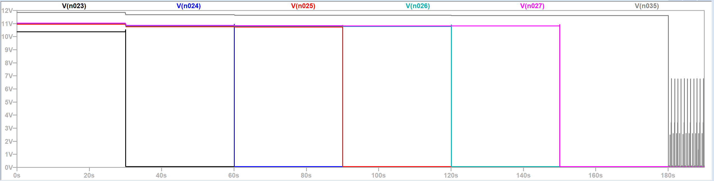

# Water Level Indicator

A six-level, conductive-probe water level indicator built entirely from discrete analog components. Five BJT switching stages light steady LEDs as the water rises; at the sixth and highest level an astable multivibrator takes over and the alarm LED blinks at about 1 Hz. The design was verified in LTspice, built on a breadboard and measured on the bench.

> **Course:** EEE 202 Circuit Theory II, Middle East Technical University Northern Cyprus Campus (Spring 2026)<br>
> **Team:** Tunay Arıcı, Mehmet Yamaç Güngör, Arda Ardıç, Yiğitalp Dellal<br>
> **Instructor:** Hussam Alraie

<p align="center">
  
</p>

**[Read the full design report (PDF, 129 pages)](report/water-level-indicator-report.pdf)** · [Presentation slides (PDF)](report/water-level-indicator-presentation.pdf)

## Contents

- [Requirements](#requirements)
- [How it works](#how-it-works)
- [Design evolution](#design-evolution)
- [Component values](#component-values)
- [Simulation](#simulation)
- [Bench measurements](#bench-measurements)
- [Limitations and next steps](#limitations-and-next-steps)
- [Repository layout](#repository-layout)

## Requirements

| Parameter | Required | This design |
|---|---|---|
| Supply voltage | 5 V to 12 V | 12 V DC |
| Detected levels | at least 3 | 6 |
| Output | LEDs | 5 steady LEDs and 1 blinking alarm LED |
| Sensing | Conductive probes | Common supply probe and six level probes |
| Implementation | Discrete analog | No microcontroller, no sensing IC |

## How it works

A common supply probe sits at the bottom of the tank, tied to the protected supply rail. When water reaches a level probe, the water itself closes the path into the base of that level's transistor.

| Stage | What it does |
|---|---|
| Reverse-polarity protection | A series 1N5819 Schottky diode blocks a reversed supply while dropping only about 0.25 V |
| Probe and base network | Water resistance plus a 10 kΩ base resistor sets the base current of a BC547B |
| Pull-down and debounce | A 1 MΩ pull-down keeps the base from floating when the probe is dry; a 1 µF capacitor holds the state through ripples and splashes |
| Level stages P1 to P5 | Each BJT acts as a low-side switch for its LED, set to about 5 mA |
| Alarm stage P6 | The sixth probe enables an astable multivibrator (68 kΩ, 10 µF) that blinks the final LED |

Because the pull-down and the capacitor form a 1 s time constant, a level stays lit while the surface settles instead of flickering on every wave. This network is better understood as a switching-time controller than as a filter: the base-emitter junction clamps the capacitor voltage, so the stage behaves as a large-signal timing element.

<p align="center">
  
</p>

## Design evolution

The circuit was developed in deliberate steps, each adding one capability.

| Version | Change | Status |
|---|---|---|
| 1 | Basic five-level BJT indicator | Superseded |
| 2 | Sixth level with blinking alarm | Superseded |
| 3 | Input stabilization and reverse-polarity protection | **Built and tested** |
| 4 | MOSFET sensing stages to cut the current through the water | Proposed |
| 5 | AC probe excitation to suppress electrolysis | Proposed |

<details>
<summary><b>Show the schematic of each version</b></summary>

**Version 1:** five identical BJT channels, each a probe, a base resistor and a low-side switch for one LED.



**Version 2:** a sixth probe enables an astable multivibrator that blinks the top LED.



**Version 3:** a 1 MΩ pull-down and a 1 µF capacitor on every base, and a 1N5819 diode in series with the supply. This is the built circuit.


**Version 4:** BS170 MOSFETs replace the sensing BJTs, with 1N4742A Zener diodes clamping each gate. The gates draw almost no current, so far less current flows through the water.



</details>

## Component values

| Component | Value | Purpose |
|---|---|---|
| Supply | 12 V DC (Agilent E3631A) | Main supply |
| Protection diode | 1N5819 Schottky | Reverse-polarity protection |
| Transistors | BC547B NPN | Low-side LED switching and alarm enable |
| Base resistor | 10 kΩ | Limits base current |
| Pull-down | 1 MΩ | Prevents floating bases |
| Debounce capacitor | 1 µF, 50 V | Holds the level state through contact noise |
| LED resistors | 1.8 kΩ and 2.0 kΩ | Sets LED current near 5 mA |
| Astable timing | 68 kΩ, 10 µF non-polarized | About 1.06 Hz blink rate |
| Total current | 30 mA to 40 mA | Low-power operation |
| Total power | 0.35 W to 0.47 W | |

Every value is derived in the appendices of the report, including a forced-beta saturation check, the effect of water resistance on base drive, LED resistor tolerance, and the astable frequency tolerance.

## Simulation

In LTspice, water contact is modelled by voltage-controlled switches in series with a 100 kΩ water path. The switches close every 30 s, imitating water reaching P1 through P6 in order. Each plot below is followed by its explanation.

### Probe triggers

<p align="center">
  
</p>

*The six switch control signals step high at 30 s, 60 s, 90 s, 120 s, 150 s and 180 s, modelling the water reaching each probe in turn.*

### Level indication

<p align="center">
  
</p>

*The five level LEDs turn on one after another and stay steady near 4.8 mA. Once P6 is reached at 180 s, the alarm LED current becomes periodic.*

### Astable multivibrator

<p align="center">
  
</p>

*The two collector voltages of the astable multivibrator switch in alternation. The blinking comes from the circuit's own oscillation, not from the probe signal.*

### Alarm LED

<p align="center">
  
</p>

*Zoomed in after P6 is reached: the alarm LED current switches between zero and about 4.8 mA at roughly 1 Hz.*

### Supply current

<p align="center">
  
</p>

*Each new level draws about 5 mA more, so the supply current climbs in steps and reaches roughly 40 mA when the alarm is active.*

<details>
<summary><b>More simulation results</b></summary>

### Input triggering and RC delay

<p align="center">
  
</p>

*Zoomed in at the first probe: the base voltage follows the switch only after a short delay, while the debounce capacitor charges.*

### Base voltages

<p align="center">
  
</p>

*Each base rises to about 0.69 V when its probe is reached, confirming that the base-emitter junction is forward biased.*

### Collector voltages

<p align="center">
  
</p>

*Each collector falls from about 11 V to near 0 V as its transistor saturates and pulls its LED to ground.*

### Protected rail under load

<p align="center">
  
</p>

*The 12 V source (black) stays flat while the rail after the Schottky diode (blue) sags by only about 0.25 V at full load.*

### Supply power

<p align="center">
  
</p>

*Power drawn from the supply rises with each level and stays below 0.5 W even with the alarm running.*

</details>

### Running the simulations

The LTspice source for every version is in [`simulation/`](simulation/). Open any `.asc` file in LTspice XVII or later and press Run; the transient analysis (190 s) is already set up.

| File | Circuit |
|---|---|
| `v1-five-level-bjt.asc` | Version 1 |
| `v2-sixth-level-alarm.asc` | Version 2 |
| `v3-implemented.asc` | Version 3, the built circuit |
| `v4-mosfet-proposed.asc` | Version 4, with a sweep of the water resistance over 10 kΩ, 50 kΩ, 100 kΩ, 500 kΩ, 1 MΩ, 2 MΩ and 5 MΩ |

The BC547B, 1N5819 and BS170 models come from LTspice's standard library or are defined inside the schematics. Version 4 also needs `zener.lib` for the 1N4742A Zener diodes; keep it in the same folder as the `.asc` file.

## Bench measurements

| Quantity | Expected | Measured |
|---|---|---|
| Input supply | 12 V | 12.01 V |
| Protected rail | about 11.7 V | 11.756 V |
| Schottky drop | about 0.3 V | 0.254 V |
| Activation order | P1 to P6 | P1 to P6 |
| Supply current | stepwise increase | 5 mA at P1 to 38 mA at P6 |
| LED current | few mA | 3.91 mA to 4.09 mA |
| BJT on | V<sub>BE</sub> forward, V<sub>CE</sub> low | V<sub>BE</sub> = 0.729 V, V<sub>CE</sub> = 19.3 mV |
| BJT off | V<sub>BE</sub> near 0, V<sub>CE</sub> high | V<sub>BE</sub> = 3.25 mV, V<sub>CE</sub> = 9.62 V |
| Alarm blink rate | 1.06 Hz | 1.00 Hz (10 blinks in 10 s) |

The physical circuit reproduced the full operating sequence predicted by simulation.

## Limitations and next steps

The main weakness of the design is that it senses with DC current through the water.

- **Water conductivity.** The BJT stages need base current through the water, so performance changes with the water's resistance.
- **Electrolysis.** DC current through metal probes slowly corrodes them; the common supply probe acts as the sacrificial electrode.
- **Version 4.** MOSFET stages are voltage-driven, so they need almost no current through the water and hold their output up to a calculable maximum water resistance.
- **Version 5.** AC excitation of the probes would remove the net DC current that drives electrolysis.

## Repository layout

```
water-level-indicator/
├── README.md
├── report/
│   ├── water-level-indicator-report.pdf
│   └── water-level-indicator-presentation.pdf
├── simulation/   LTspice .asc files for Versions 1 to 4, and zener.lib
└── media/
    ├── breadboard.jpg
    ├── schematics/   LTspice schematics of Versions 1 to 4
    └── simulation/   LTspice waveform plots
```
