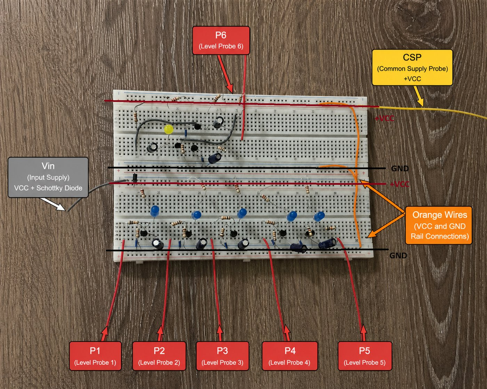

# Water Level Indicator

A six-level, conductive-probe water level indicator built entirely from discrete analog components. Five BJT switching stages light steady LEDs as the water rises; at the sixth and highest level an astable multivibrator takes over and the alarm LED blinks at about 1 Hz. The design was verified in LTspice, built on a breadboard and measured on the bench.

> **Course:** EEE 202 Circuit Theory II, Middle East Technical University Northern Cyprus Campus (Spring 2026) 
> **Team:** Tunay Arıcı, Mehmet Yamaç Güngör, Arda Ardıç, Yiğitalp Dellal 
> **Instructor:** Hussam Alraie

  

**[Read the full design report (PDF, 129 pages)](report/water-level-indicator-report.pdf)** · [Presentation slides (PDF)](report/water-level-indicator-presentation.pdf)

## Contents

- [Requirements](#requirements)
- [How it works](#how-it-works)
- [Design evolution](#design-evolution)
- [Component values](#component-values)
- [Simulation](#simulation)
- [Bench measurements](#bench-measurements)
- [Limitations and next steps](#limitations-and-next-steps)
- [Repository layout](#repository-layout)

## Requirements

| Parameter | Required | This design |
|---|---|---|
| Supply voltage | 5 V to 12 V | 12 V DC |
| Detected levels | at least 3 | 6 |
| Output | LEDs | 5 steady LEDs and 1 blinking alarm LED |
| Sensing | Conductive probes | Common supply probe and six level probes |
| Implementation | Discrete analog | No microcontroller, no sensing IC |

## How it works

A common supply probe sits at the bottom of the tank, tied to the protected supply rail. When water reaches a level probe, the water itself closes the path into the base of that level's transistor.

| Stage | What it does |
|---|---|
| Reverse-polarity protection | A series 1N5819 Schottky diode blocks a reversed supply while dropping only about 0.25 V |
| Probe and base network | Water resistance plus a 10 kΩ base resistor sets the base current of a BC547B |
| Pull-down and debounce | A 1 MΩ pull-down keeps the base from floating when the probe is dry; a 1 µF capacitor holds the state through ripples and splashes |
| Level stages P1 to P5 | Each BJT acts as a low-side switch for its LED, set to about 5 mA |
| Alarm stage P6 | The sixth probe enables an astable multivibrator (68 kΩ, 10 µF) that blinks the final LED |

Because the pull-down and the capacitor form a 1 s time constant, a level stays lit while the surface settles
